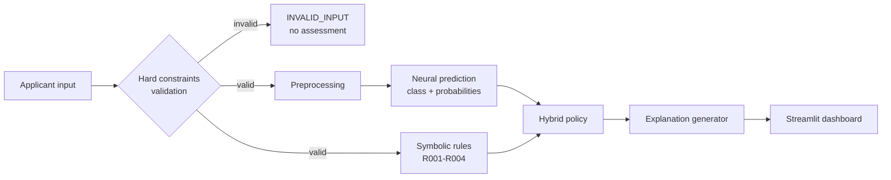

# 🧠 Neuro-Symbolic Reasoning Engine


A compact, fully runnable **hybrid AI system** that combines a **machine-learning classifier** (learned patterns) with an **explicit IF–THEN rule engine** (symbolic reasoning), joined by a **transparent, configurable decision policy** that explains every result in plain English.

Loan-risk classification is used purely as an illustrative demo domain.

> ⚠️ **Disclaimer.** This is an **educational prototype** trained on **synthetic data** with **illustrative thresholds**. It is **not** a validated credit-scoring or lending system, and its results say nothing about real-world financial prediction. It is a practical hybrid-reasoning architecture, not a claim of solved neuro-symbolic reasoning or AGI.

---

## Table of Contents
1. [Why this project](#-why-this-project)
2. [Key features](#-key-features)
3. [Architecture](#-architecture)
4. [Quick start](#-quick-start)
5. [Example output](#-example-output)
6. [Symbolic rules & constraints](#-symbolic-rules--constraints)
7. [Hybrid decision policy](#-hybrid-decision-policy)
8. [Dataset & ML model](#-dataset--ml-model)
9. [Evaluation results](#-evaluation-results)
10. [Testing](#-testing)
11. [Project structure](#-project-structure)
12. [Design decisions](#-design-decisions)
13. [Limitations](#-limitations)
14. [Roadmap](#-roadmap)
15. [Author & license](#-author--license)

---

## 🎯 Why this project

Pure ML models are good at fuzzy statistical patterns but are hard to audit. Pure rule systems are transparent but brittle. This project shows a small, honest way to combine them:

- the **model** supplies calibrated-ish probabilities over risk classes,
- the **rules** supply explicit, checkable evidence with severities,
- a **policy** decides what happens when the two disagree, **without blindly overriding** either side.

It demonstrates neuro-symbolic integration, constraint-based reasoning, knowledge representation (rules as data), explainability, leakage-safe ML, and reproducible evaluation, with no LLMs, no deep learning and no cloud services.

## ✨ Key features

| Feature | Details |
|---|---|
| **Neural component** | Random Forest in a scikit-learn `Pipeline` (scaler fit on training data only → no leakage) |
| **Symbolic component** | 4 risk rules + 4 families of hard input constraints, each returning ID, condition, fired flag, severity, evidence and explanation |
| **Hybrid reasoning** | Severity-weighted rule score → risk *floor*; conflicts resolved by model confidence |
| **Explainability** | Every output states the model's view, which rules fired, whether they agree, and why the final call was made |
| **Evaluation** | Accuracy / precision / recall / F1, confusion matrices, rule frequencies, agreement rates, invalid-input detection, explanation coverage, error cases, runtime, **policy sensitivity sweep** |
| **Interface** | Streamlit dashboard with example cases and live policy sliders |
| **Quality** | 60 unit and integration tests, fixed seeds, modular code |

## 🏗 Architecture



## 🚀 Quick start

Requires Python 3.11+ (tested on 3.12). Works on Windows, macOS and Linux.

```bash
# 1. create an environment (Windows PowerShell shown)
python -m venv .venv
.venv\Scripts\activate          # macOS/Linux: source .venv/bin/activate

# 2. install
pip install -r requirements.txt

# 3. generate data + train + save the model
python train.py

# 4. run the tests
pytest

# 5. run the full evaluation (writes ./reports)
python evaluate.py

# 6. console demo of agreement / conflict / invalid cases
python demo.py

# 7. interactive dashboard
streamlit run app.py
```

If `models/risk_model.joblib` doesn't exist, the dashboard trains one automatically on first launch.

### Use it from Python

```python
from nsre.engine import ReasoningEngine
from nsre.model import load_bundle

engine = ReasoningEngine(load_bundle())
result = engine.assess({
    "annual_income": 120000, "debt_to_income": 0.47,
    "credit_history_years": 15, "missed_payments": 3, "savings_ratio": 0.40,
})
print(result.hybrid_risk)      # e.g. "high"
print(result.explanation)      # full human-readable trace
```

## 🔍 Example output

A case where the **model and rules disagree** (model is unsure; two high-severity rules fire):

```text
HYBRID RESULT: HIGH illustrative risk (source: symbolic_escalation).
Neural prediction: medium (confidence 44%; probabilities: high=0.38, low=0.18, medium=0.44).
Symbolic findings (2 rule(s) fired, score 6, floor 'high'):
  - [R001] Frequent missed payments [high]: Applicant has 3 missed payments (threshold: >= 3).
      condition: IF missed_payments >= 3 THEN flag frequent missed payments
  - [R002] High debt burden [high]: Debt-to-income ratio is 0.47 (threshold: > 0.45).
      condition: IF debt_to_income > 0.45 THEN flag high debt burden
Agreement: NO (rules_higher).
Why: CONFLICT: rules imply at least high (score 6); model predicted medium with only 44% confidence. Escalated to high.
```

An **invalid input** is rejected rather than scored:

```text
RESULT: INVALID INPUT - no risk assessment was produced.
  - [C003:debt_to_income] 'debt_to_income' = 2.5 is outside the valid range [0.0, 1.5].
```

## 📐 Symbolic rules & constraints

**Soft risk rules** (evidence that feeds the policy; thresholds are illustrative, not lending criteria):

| ID | Rule | Severity (weight) |
|---|---|---|
| R001 | IF `missed_payments >= 3` THEN flag frequent missed payments | high (3) |
| R002 | IF `debt_to_income > 0.45` THEN flag high debt burden | high (3) |
| R003 | IF `credit_history_years < 2` THEN flag limited credit history | moderate (2) |
| R004 | IF `savings_ratio < 0.05` THEN flag thin savings buffer | low (1) |

**Hard input constraints** (preconditions; a violation blocks any assessment):

| ID | Constraint |
|---|---|
| C001 | Every required field is present |
| C002 | Value is numeric and finite (no text, NaN or infinity) |
| C003 | Value lies in its valid range: income 0–5M, DTI 0–1.5, history 0–80 yrs, missed payments 0–60, savings 0–1 |
| C004 | `missed_payments` is a whole number |

Validation is deliberately separate from risk rules: an impossible record isn't "risky", it's *invalid*.

## ⚖️ Hybrid decision policy

Defined in plain English here and in code in [`nsre/hybrid.py`](nsre/hybrid.py) (`PolicyConfig`).

1. **Validate first.** If any hard constraint fails → `INVALID_INPUT`. Nothing else runs.
2. **Score the rules.** Sum the severity weights of fired rules. Score ≥ 5 → floor **high**; ≥ 3 → floor **medium**; otherwise **low**.
3. **Compare with the model:**

| Situation | Agreement type | Outcome |
|---|---|---|
| Model class = floor | `consistent` | Keep model class |
| Model class > floor | `neural_higher` | Keep model class (rules don't contradict it) |
| Model class < floor, model confidence ≥ 0.90 | `rules_higher` | **Keep model, flag for manual review** |
| Model class < floor, model confidence < 0.90 | `rules_higher` | **Escalate to the rules' floor** |

4. **Asymmetry by design.** Rules can only *raise* risk, never lower it.
5. **Everything is configurable**: score thresholds and the confidence cutoff are parameters (and sliders in the dashboard).

`agree = False` only when the rules demand a higher class than the model produced.

## 📊 Dataset & ML model

- **Synthetic data**, 2,000 applicants, fixed seed (42). Assumptions are documented in [`nsre/data.py`](nsre/data.py).
- **Features:** annual income, debt-to-income ratio, credit-history length, missed payments, savings ratio.
- **Target:** `low` / `medium` / `high` illustrative risk, produced from a hand-written noisy linear risk score cut at 40% / 35% / 25% quantiles (so mild, deliberate class imbalance).
- **Split:** stratified 80/20. Scaler lives inside the sklearn `Pipeline`, so it is fit on training data only.
- **Model:** Random Forest (200 trees, `min_samples_leaf=3`), saved with Joblib.

> **Honesty note:** the labels are generated from the *same features* the model and rules see, so the model can recover the formula and the rules align with the labels partly by construction. Treat the metrics as proof that the pipeline works, not as evidence of real-world predictive power.

## 📈 Evaluation results

Seed 42, 400-row held-out test set. Reproduce with `python evaluate.py`. Full output is in [`reports/report.md`](reports/report.md).

| Measure | Result |
|---|---|
| Random Forest accuracy / macro-F1 | **0.755 / 0.757** |
| Hybrid-vs-truth accuracy / macro-F1 | 0.752 / 0.755 |
| Rules fired (R001 / R002 / R003 / R004) | 7.5% / 17.8% / 3.8% / 9.8% |
| Cases with 2+ rules firing together | 4.8% |
| Agreement: consistent / neural_higher / rules_higher | 43.8% / 55.0% / 1.2% |
| Hybrid changed the model's class | 1.2% (5 cases) |
| Invalid-input detection (260 corrupted records) | **100%** caught, 0% false alarms on valid rows |
| Explanation coverage (valid cases) | 100% |
| Runtime, full pipeline | ~16 ms per prediction |

**What the results actually say**

- Rules rarely conflict with the model on this data, so the hybrid stays close to the neural baseline. That is reported, not hidden.
- The **policy sensitivity sweep** (`reports/policy_sweep.csv`) shows the trade-off: very aggressive floors raise high-class recall from 0.75 to 0.82 but drop precision from 0.79 to 0.66 and overall accuracy to 0.715.
- 100% explanation coverage is true *by construction* (outputs are templated). It shows traceability, not explanation quality.

Generated figures (in `reports/`): `cm_neural.png`, `cm_hybrid.png`, `rule_frequency.png`, `agreement.png`, `decision_sources.png`. Error-analysis CSVs: `cases_false_positives.csv`, `cases_false_negatives.csv`, `cases_disagreements.csv`.

<p align="center">
  
  
</p>

## 🧪 Testing

```bash
pytest -q        # 60 tests, ~0.2 s
```

Covers: every rule and its boundary values (strict `>` vs `>=`), valid and invalid inputs, inclusive range limits, type errors, multiple rules firing together, all policy branches (consistent / escalate / retain-with-warning), the "rules never lower risk" property, dataset reproducibility, end-to-end engine behaviour and deterministic inference.

## 🗂 Project structure

```text
neuro_symbolic_engine/
├── nsre/
│   ├── config.py        # paths, seed, feature schema, ranges, thresholds
│   ├── data.py          # synthetic data + corrupted-record generator
│   ├── validation.py    # hard constraints (C001-C004)
│   ├── model.py         # Pipeline + Random Forest, save/load, predictor
│   ├── rules.py         # symbolic rules R001-R004
│   ├── hybrid.py        # hybrid decision policy
│   ├── engine.py        # end-to-end ReasoningEngine
│   ├── explain.py       # human-readable explanations
│   └── metrics.py       # metrics and error-analysis helpers
├── tests/               # pytest suite (60 tests)
├── app.py               # Streamlit dashboard
├── train.py             # generate data, train, save model
├── evaluate.py          # full evaluation -> reports/
├── demo.py              # console demo
├── reports/             # generated report, figures, CSVs
├── requirements.txt
└── README.md
```

## 🧭 Design decisions

- **Hard vs soft separation.** Invalid data short-circuits the pipeline; risk rules only add evidence.
- **No blind overrides.** A very confident model is not overruled by a single crude rule; it is flagged for human review instead.
- **Rules only raise risk.** Missing a high-risk case is treated as costlier than a false alarm, which is a deliberately conservative bias.
- **Lightweight stack.** No LLM, deep learning or cloud, so everything is inspectable and runs on an ordinary laptop.
- **Honest evaluation.** Limitations and circularity are stated up front, and a sensitivity sweep shows the policy's trade-offs instead of one flattering number.

## ⚠️ Limitations

- Synthetic data with labels derived from the same features: results are **not** real-world evidence.
- Single train/test split and single seed; no cross-validation or confidence intervals.
- Rules and thresholds are hand-picked and illustrative; no calibration analysis of model probabilities.
- No fairness or bias analysis. **Do not use for real lending decisions.**

## 🛣 Roadmap

- [ ] Cross-validation and confidence intervals
- [ ] Probability calibration check for the Random Forest
- [ ] Learn rule weights and thresholds from data
- [ ] Small forward-chaining logic layer for multi-step inference
- [ ] Fairness audit on synthetic protected attributes
- [ ] Docker image and GitHub Actions CI

## 👤 Author
Vedashree Nitin Mirajkar


